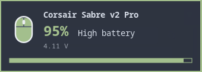

# 🖱️ SabreBat


[](LICENSE)
[](https://github.com/Evilchuck666/SabreBat/releases/latest)
[](https://github.com/Evilchuck666/SabreBat/actions/workflows/release.yaml)

**Know when your mouse needs a charge.**

SabreBat shows the battery level of the **Corsair Sabre v2 Pro** wireless mouse on Linux.
Neither the kernel nor UPower report it, so SabreBat asks the USB receiver directly through
hidraw and prints the level, hands a bare number to your status bar, or pops up a desktop
notification. Left running in the background, it tells you when to plug the charging cable in
and when to unplug it. 🔋

🌐 **Website:** https://evilchuck666.github.io/SabreBat/

<!-- SCREENSHOTS:START -->
## 🎬 Screenshot



The notification on a Nord-themed dunst: the icon fills up and changes colour with the level.

<!-- SCREENSHOTS:END -->

## ✨ Features

-   **Three outputs**: a readable line, just the percentage, or a desktop notification. 🖥️
-   **Coloured levels**: green, yellow, orange and red, with critical urgency at 10 % or less. 🚦
-   **Progress bar and live icon**: the notification icon is a mouse that fills up with the charge. 📊
-   **Battery alerts**: `--daemon` suggests plugging the cable in at 20 % on battery and unplugging it at 90 % while charging. 🔔
-   **No vendor software**: no sudo and no Python dependencies; a udev rule grants access. 🔓
-   **Launcher ready**: a desktop entry for rofi and app menus. 🚀
-   **Safe by design**: it only ever sends the read-only battery query to the mouse. 🛡️

## 📥 Download

| Channel | Package |
| --- | --- |
| Arch Linux (AUR) | [sabrebat](https://aur.archlinux.org/packages/sabrebat) |
| PyPI | [SabreBat](https://pypi.org/project/SabreBat/) |
| GitHub release | [Wheel (v0.2.0)](https://github.com/Evilchuck666/SabreBat/releases/download/v0.2.0/sabrebat-0.2.0-py3-none-any.whl) · [Source archive](https://github.com/Evilchuck666/SabreBat/releases/download/v0.2.0/sabrebat-0.2.0.tar.gz) · [All downloads](https://github.com/Evilchuck666/SabreBat/releases/latest) |

[Release notes](https://github.com/Evilchuck666/SabreBat/releases/latest) · [SHA256SUMS.txt](https://github.com/Evilchuck666/SabreBat/releases/latest/download/SHA256SUMS.txt)

## 🚀 Getting started

### 🏹 On Arch‑based systems

SabreBat is available in the AUR, with its udev rule, desktop entry and icon:

```bash
yay -S sabrebat
```

### 🐍 From PyPI

```bash
pip install SabreBat
```

Then install the udev rule yourself (see Requirements below).

### ▶️ First run

Unplug the receiver and plug it back in once the udev rule is installed, move the mouse so it is awake, and run:

```bash
sabre-bat
# Sabre v2 Pro: 95%  (4118 mV, on battery)
```

## 📋 Requirements

-   Python 3.10+ 🐍
-   The Sabre v2 Pro USB receiver (`1b1c:2b2a`) plugged in
-   Read/write access to its hidraw node, given by a udev rule
-   `notify-send` (libnotify) and a notification daemon, for `--notify` only

### 🔓 udev rule

The AUR package installs it. With any other installation, create
`/etc/udev/rules.d/70-sabrebat.rules` with the content of
[`data/70-sabrebat.rules`](data/70-sabrebat.rules):

```bash
echo 'SUBSYSTEM=="hidraw", ATTRS{idVendor}=="1b1c", ATTRS{idProduct}=="2b2a", TAG+="uaccess"' \
  | sudo tee /etc/udev/rules.d/70-sabrebat.rules
sudo udevadm control --reload
```

and replug the receiver. The rule gives the user logged in at the seat access to the receiver,
as systemd-logind or elogind do for sound cards.

### Installing libnotify

### 🐧 Arch‑based distributions (Arch Linux, EndeavourOS, Manjaro, etc.)

```bash
sudo pacman -S python libnotify
```

### 🐧 Debian‑based distributions (Debian, Ubuntu, Linux Mint, etc.)

```bash
sudo apt install python3 libnotify-bin
```

### 🐧 Fedora‑based distributions (Fedora, CentOS, etc.)

```bash
sudo dnf install python3 libnotify
```

## 🎮 Usage

```bash
sabre-bat [OPTIONS]
```

| Option | Description |
|:-------|:------------|
| *(none)* | Print the level, voltage and whether it is charging |
| `-q`, `--quiet` | Print only the percentage, for status bars and scripts |
| `-n`, `--notify` | Show the level in a desktop notification |
| `-D`, `--daemon` | Keep running and show battery alerts (see below) |
| `-d`, `--device PATH` | Use this hidraw node instead of detecting the receiver |
| `-V`, `--version` | Show the version |

With `--daemon`:

| Option | Default | Description |
|:-------|:--------|:------------|
| `--low PERCENT` | 20 | Suggest charging at or below this level, on battery |
| `--high PERCENT` | 90 | Suggest unplugging at or above this level, while charging |
| `--interval SECONDS` | 60 | Time between readings |
| `--remind MINUTES` | 10 | Repeat an alert this often while it applies; `0` shows it once |

The exit status is 1 when the level cannot be read: the receiver is unplugged, the udev rule is
missing or the mouse is asleep (move it and try again). With `--notify` the error is shown in
the notification too.

### Launcher and shortcuts

The desktop entry **Sabre v2 Pro Battery** runs `sabre-bat --notify`, so it shows up in rofi
(`rofi -show drun`) and in application menus. With a pip installation, copy
[`data/sabre-bat.desktop`](data/sabre-bat.desktop) to `~/.local/share/applications/`.

To check the battery from a keyboard shortcut, bind `sabre-bat --notify` in your window
manager, and for a status bar module use `sabre-bat --quiet`.

The notification is styled for dunst (progress bar, colours, replacing the previous one) but
works with any notification daemon.

### 🔔 Battery alerts

`sabre-bat --daemon` keeps running and reads the battery every minute:

- at **20 % or less on battery**, it suggests plugging the charging cable in;
- at **90 % or more while charging**, it suggests unplugging it.

It knows from the mouse whether the cable is plugged in, so 20 % while charging or 90 % on
battery don't raise an alert. An alert is repeated every 10 minutes until you plug or unplug the
cable. While the mouse is asleep or the receiver is unplugged it just waits for the next reading.

Start it with your session from your window manager's autostart, for example:

```bash
# Openbox: ~/.config/openbox/autostart
(sabre-bat --daemon) >/dev/null 2>&1 &
```

```bash
# i3 or sway: config
exec sabre-bat --daemon
```

It logs to stderr: send it to a file instead of `/dev/null` to keep a record.

## 📚 Learn more

- [Technical guide](TECHNICAL_GUIDE.md): how the receiver protocol works, permissions,
  and building and installing from source.

## ⚖️ License

SabreBat is free software released under the **GNU General Public License v3.0** (GPL-3.0). See [LICENSE](LICENSE).
SabreBat is not affiliated with or endorsed by Corsair.
